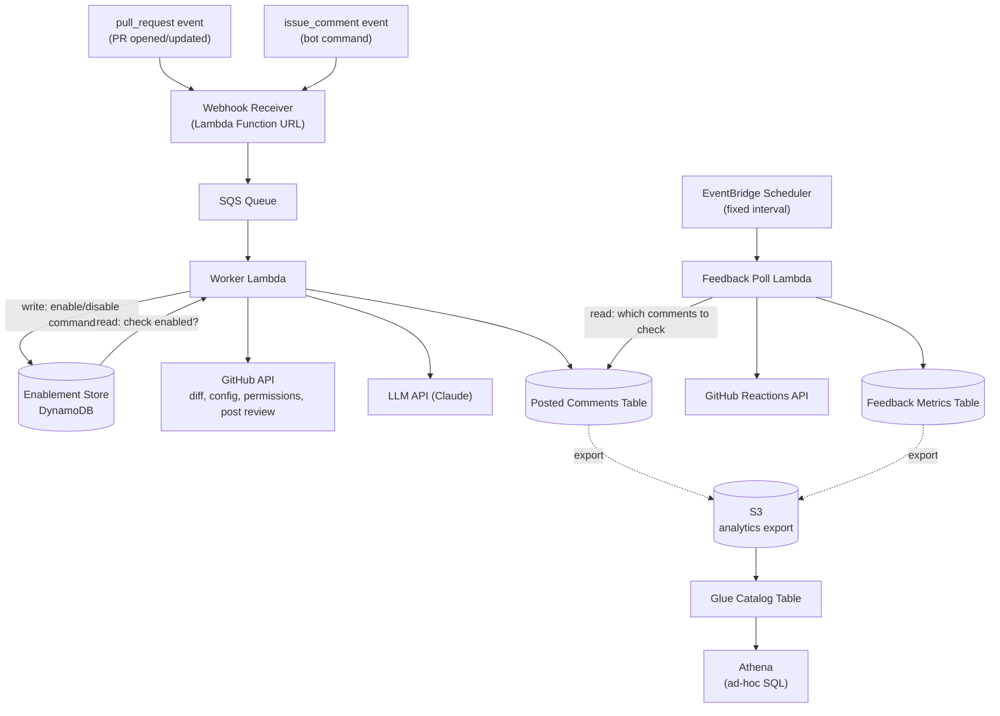

# Bob the Fixer — Architecture & Data Model

AI-powered GitHub PR reviewer, installable across teams/orgs. Reviews are opt-in per repo, configurable per repo, and instrumented for feedback.

## Architecture



## Event Triggers

Two independent GitHub webhook event types feed the same pipeline — one doesn't depend on the other:

| Event | Fires when | Worker action |
|---|---|---|
| `pull_request` | PR opened or updated | Read Enablement Store → if enabled, review |
| `issue_comment` | Any comment on a PR or issue, matching `@bob-the-fixer <command>` | Check commenter's write access via GitHub API → write Enablement Store |

**How the workflow runs**: both event types arrive at the same Receiver and flow through the same queue and Worker. The Worker inspects the event type first — a `pull_request` event triggers a read against the Enablement Store, and only proceeds to fetch the diff and call the LLM if that repo is enabled. An `issue_comment` event is checked against the bot command pattern; if it matches, the Worker verifies the commenter has write access on the repo, then writes the new enabled/disabled state. Neither path blocks the other — a repo can be enabled at any time independent of whether a PR is currently open.

## Components

| Component | Responsibility |
|---|---|
| **GitHub App** | Installed by teams; scoped permissions (PRs, contents, checks); installed broadly across an org's repos |
| **Webhook Receiver** | Verifies signature, pushes event to SQS, responds within GitHub's 10s window |
| **SQS Queue** | Buffers events between receipt and processing |
| **Worker Lambda** | Exchanges JWT → installation token; branches on event type: PR review, or `enable`/`disable`/`status` command. For reviews, maps LLM findings to diff positions (file + hunk offset) before posting inline comments |
| **Enablement Store** | Per-repo on/off flag, since repos are installed broadly but reviewed only when explicitly enabled |
| **Posted Comments Table** | Records every comment Bob posts, so feedback can be polled later |
| **Feedback Poll Lambda** | Invoked on a fixed interval by EventBridge Scheduler; reads recent rows from Posted Comments, checks reaction counts on each via the GitHub Reactions API |
| **Feedback Metrics Table** | Stores 👍/👎 counts per comment, the core quality signal |
| **S3 (analytics export)** | Destination for DynamoDB's native export-to-S3 — periodic snapshot of Posted Comments + Feedback Metrics, not a live sync |
| **Glue Catalog Table** | Schema definition over the S3 export so Athena knows how to read it — no crawler pipeline needed while the schema is stable and hand-defined |
| **Athena** | Ad-hoc SQL over the export — feedback trends, per-repo rollups, joins between the two tables; billed per query scanned, nothing running idle |

## Data Model

### Enablement Store

| Field | Type | Notes |
|---|---|---|
| `repo_id` | string (PK) | GitHub repo ID |
| `enabled` | boolean | Default `false` — opt-in only |
| `enabled_by` | string | GitHub username who ran `enable` |
| `enabled_at` | timestamp | |
| `disabled_at` | timestamp, nullable | Set when disabled |

### Posted Comments Table

Bob posts one review per PR containing multiple inline comments — each line-level comment gets its own row.

| Field | Type | Notes |
|---|---|---|
| `comment_id` | string (PK) | GitHub comment ID, returned on post |
| `repo_id` | string | Needed to call the Reactions API (`owner/repo` + `comment_id`) |
| `pr_number` | int | Needed to re-fetch the PR's current diff for the acted-upon-rate metric |
| `file_path` | string | File the comment is anchored to — needed for acted-upon-rate |
| `line` | int | Line number the comment is anchored to — needed for acted-upon-rate |
| `posted_at` | timestamp | Drives the poll window; also the GSI partition key (see below) |
| `last_checked_at` | timestamp, nullable | Set by the feedback poll job |

**GSI**: partition key = `posted_at` truncated to date (e.g. `"2026-09-13"`), no sort key. A base-table Scan would get slower and costlier every month as history piles up; querying this GSI for a small number of day-bucket values (see poll window below) is fast and cheap instead. No sort key needed — the poll job takes everything in a day's bucket rather than a sub-day range, and any real trend/rollup analysis happens in Athena, not against this table directly.

### Feedback Metrics Table

| Field | Type | Notes |
|---|---|---|
| `comment_id` | string (PK) | Joins to Posted Comments |
| `thumbs_up` | int | Snapshot count, not a delta |
| `thumbs_down` | int | Snapshot count, not a delta |
| `checked_at` | timestamp | Last time this row was refreshed |

`repo_id`/`pr_number` aren't duplicated here — they're only needed to make the Reactions API call, which happens from Posted Comments; any per-repo or per-PR rollup joins back on `comment_id` rather than storing them twice.

Reactions API returns a current total each call — polling overwrites `thumbs_up`/`thumbs_down`, no incremental math needed.

## Config File (per repo)

Controls review instructions only — not enablement.

```yaml
review_focus:
  - security
  - bugs
  - performance
ignore_paths:
  - "*.lock"
  - "vendor/**"
custom_instructions: |
  Flag missing null checks on API responses.
severity_threshold: warning
```

## Bot Commands

Issued as PR/issue comments; require `write` access on the target repo (checked via GitHub's collaborator-permission API before acting):

- `@bob-the-fixer enable`
- `@bob-the-fixer disable`
- `@bob-the-fixer status`

## Notes / Future Work

- The `enable`/`disable` write is a simple, fast operation (unlike the LLM review call) — the Receiver could handle it synchronously and skip SQS entirely, avoiding queue latency for something users expect to feel instant. Only `pull_request` events strictly need the queue, since only that path has a slow LLM call to buffer against.
- Inline comments require mapping LLM findings (file + line) to GitHub's diff "position" (offset within the unified diff hunk, not the absolute file line) — GitHub's Review API rejects positions outside the diff's visible hunks. A finding on such a line is dropped rather than surfaced elsewhere; prompt design should constrain the LLM to only flag lines actually present in the diff, validated during testing against real PR shapes.
- GitHub has no webhook event for reactions being added/removed on a comment (only `created`/`edited`/`deleted` on the comment itself) — this is a known gap, tracked in an open GitHub feature request. Polling the Reactions API is the only option today; both the Posted Comments table (what to check) and Feedback Metrics table (poll results) stay in the design because of this — only the trigger (EventBridge Scheduler instead of Airflow) changed.
- Feedback poll window: start at T-2/T-3 (recheck comments from the last 2-3 days), not a full week — most reactions land while a PR is still actively being reviewed, so rechecking further back mostly re-hits the Reactions API for comments that already got their reactions. Widen later only if real data shows meaningful engagement arriving later than that.
- Aggregate views (acted-upon rate, per-repo adoption) are computed in Athena over the S3 export, not stored separately or computed against the live DynamoDB tables.
- The S3 export is a periodic snapshot (DynamoDB's built-in export-to-S3), not a continuous sync — Feedback Metrics rows are overwritten in place (snapshot counts, not deltas), so each export is a fresh full copy rather than an incremental append. Fine at this scale; revisit (e.g. Iceberg upserts) only if repeated full exports become a real cost or freshness problem.
- Config file validation should fail safe (skip review, log) rather than fail loud.
