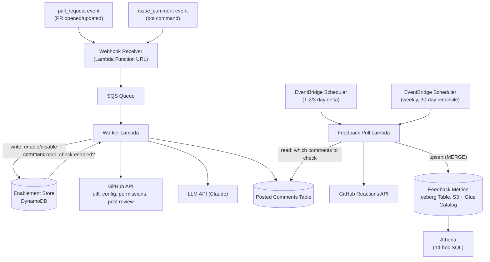

# Bob the Fixer — Architecture & Data Model

AI-powered GitHub PR reviewer, installable across teams/orgs. Reviews are opt-in per repo, configurable per repo, and instrumented for feedback.

## Architecture



## Event Triggers

Two independent GitHub webhook event types feed the same pipeline — one doesn't depend on the other:

| Event | Fires when | Worker action |
|---|---|---|
| `pull_request` | PR opened or updated | Read Enablement Store → if enabled, review |
| `issue_comment` | Any comment on a PR or issue, matching `@bob-the-fixer <command>` | Check commenter's write access via GitHub API → write Enablement Store |

**How the workflow runs**: both event types arrive at the same Receiver and flow through the same queue and Worker. The Worker inspects the event type first — a `pull_request` event triggers a read against the Enablement Store, and only proceeds to fetch the diff and call the LLM if that repo is enabled. An `issue_comment` event is checked against the bot command pattern; if it matches, the Worker verifies the commenter has write access on the repo, then writes the new enabled/disabled state. Neither path blocks the other — a repo can be enabled at any time independent of whether a PR is currently open.

## Components

| Component | Responsibility |
|---|---|
| **GitHub App** | Installed by teams; scoped permissions (PRs, contents, checks); installed broadly across an org's repos |
| **Webhook Receiver** | Verifies signature, pushes event to SQS, responds within GitHub's 10s window |
| **SQS Queue** | Buffers events between receipt and processing |
| **Worker Lambda** | Exchanges JWT → installation token; branches on event type: PR review, or `enable`/`disable`/`status` command. For reviews, maps LLM findings to diff positions (file + hunk offset) before posting inline comments |
| **Enablement Store** | Per-repo on/off flag, since repos are installed broadly but reviewed only when explicitly enabled |
| **Posted Comments Table** | Records every comment Bob posts, so feedback can be polled later. Purely operational — never exported, no analytics consumer reads it directly |
| **Feedback Poll Lambda** | A batch upsert job, invoked by two EventBridge Scheduler rules with different lookback windows (see below); for each candidate row from Posted Comments, checks reaction counts via the GitHub Reactions API, then merges the result straight into the Feedback Metrics Iceberg table |
| **Feedback Metrics (Iceberg Table)** | S3-backed, Glue Catalog-registered Iceberg table — the single analytics source of truth. Stores 👍/👎 counts per comment, denormalized with repo/PR/file context so Athena never has to join. Written directly by the Feedback Poll Lambda via `MERGE`/upsert — no intermediate DynamoDB table, no export step |
| **Athena** | Ad-hoc SQL directly over the Iceberg table — feedback trends, per-repo rollups; billed per query scanned, nothing running idle. Freshness is bounded by the poll schedule, not by a separate export cadence on top of it |

## Data Model

### Enablement Store

| Field | Type | Notes |
|---|---|---|
| `repo_id` | string (PK) | GitHub repo ID |
| `enabled` | boolean | Default `false` — opt-in only |
| `enabled_by` | string | GitHub username who ran `enable` |
| `enabled_at` | timestamp | |
| `disabled_at` | timestamp, nullable | Set when disabled |

### Posted Comments Table

Bob posts one review per PR containing multiple inline comments — each line-level comment gets its own row.

| Field | Type | Notes |
|---|---|---|
| `comment_id` | string (PK) | GitHub comment ID, returned on post |
| `repo_id` | string | Needed to call the Reactions API (`owner/repo` + `comment_id`) |
| `pr_number` | int | Needed to re-fetch the PR's current diff for the acted-upon-rate metric |
| `file_path` | string | File the comment is anchored to — needed for acted-upon-rate |
| `line` | int | Line number the comment is anchored to — needed for acted-upon-rate |
| `posted_at` | timestamp | Drives the poll window; also the GSI partition key (see below) |
| `last_checked_at` | timestamp, nullable | Set by the feedback poll job |

**GSI**: partition key = `posted_at` truncated to date (e.g. `"2026-09-13"`), no sort key. A base-table Scan would get slower and costlier every month as history piles up; querying this GSI for a small number of day-bucket values (see poll windows below) is fast and cheap instead — both the T-2/3 day delta poll and the 30-day reconciliation poll query this same GSI, just over a different number of day-buckets.

### Feedback Metrics (Iceberg Table — S3 + Glue Catalog)

Not a DynamoDB table. Written directly by the Feedback Poll Lambda via an upsert/`MERGE` keyed on `comment_id`, and read directly by Athena — no intermediate store, no export step. `repo_id`/`pr_number`/`file_path`/`line` are copied over from Posted Comments at poll time (deliberately denormalized, not joined at query time), so this one table is a complete analytics record on its own.

| Field | Type | Notes |
|---|---|---|
| `comment_id` | string | Merge key |
| `repo_id` | string | Denormalized from Posted Comments — avoids a join in Athena |
| `pr_number` | int | Denormalized from Posted Comments |
| `file_path` | string | Denormalized from Posted Comments — needed for acted-upon-rate |
| `line` | int | Denormalized from Posted Comments |
| `thumbs_up` | int | Snapshot count, not a delta |
| `thumbs_down` | int | Snapshot count, not a delta |
| `checked_at` | timestamp | Last time this row was refreshed |

Reactions API returns a current total each call — the merge overwrites `thumbs_up`/`thumbs_down`/`checked_at` for matching `comment_id`s, no incremental math needed. A comment not yet polled even once (posted after the Lambda's last run) simply has no row yet — an acceptable, short-lived gap given the poll cadence.

## Config File (per repo)

Controls review instructions only — not enablement.

```yaml
review_focus:
  - security
  - bugs
  - performance
ignore_paths:
  - "*.lock"
  - "vendor/**"
custom_instructions: |
  Flag missing null checks on API responses.
severity_threshold: warning
```

## Bot Commands

Issued as PR/issue comments; require `write` access on the target repo (checked via GitHub's collaborator-permission API before acting):

- `@bob-the-fixer enable`
- `@bob-the-fixer disable`
- `@bob-the-fixer status`

## Notes / Future Work

- The `enable`/`disable` write is a simple, fast operation (unlike the LLM review call) — the Receiver could handle it synchronously and skip SQS entirely, avoiding queue latency for something users expect to feel instant. Only `pull_request` events strictly need the queue, since only that path has a slow LLM call to buffer against.
- Inline comments require mapping LLM findings (file + line) to GitHub's diff "position" (offset within the unified diff hunk, not the absolute file line) — GitHub's Review API rejects positions outside the diff's visible hunks. A finding on such a line is dropped rather than surfaced elsewhere; prompt design should constrain the LLM to only flag lines actually present in the diff, validated during testing against real PR shapes.
- GitHub has no webhook event for reactions being added/removed on a comment (only `created`/`edited`/`deleted` on the comment itself) — this is a known gap, tracked in an open GitHub feature request. Polling the Reactions API is the only option today; the Posted Comments table (what to check) stays in the design because of this.
- Feedback Poll Lambda runs on two independent EventBridge Scheduler rules, same code, different lookback window passed in the event payload:
  - **Delta poll, T-2/3 days**, on a short fixed interval — catches the large majority of reactions, which land while a PR is still actively being reviewed.
  - **Reconciliation poll, 30 days, weekly** — catches reactions that arrive later than the delta window covers (edge case, not the common path). Bounded at 30 days rather than full history, so the job's cost doesn't grow with total lifetime comment volume; widen only if real data shows meaningful engagement arriving later than that.
- **Feedback Metrics is an Iceberg table (S3 + Glue Catalog), not DynamoDB** — this was a deliberate choice, not a fallback: the table has no operational/low-latency consumer, only Athena, so there was no reason to stage writes in DynamoDB first and export afterward. Writing straight into Iceberg via `MERGE` removes that whole intermediate hop, replaces the old full-table-snapshot export with a true incremental upsert, and (via the denormalized `repo_id`/`pr_number`/`file_path` columns) removes the need for Posted Comments to be exported or joined at query time at all. Posted Comments remains DynamoDB because it *does* have a real operational access pattern (the Worker's write path, the poll job's GSI query).
- Aggregate views (acted-upon rate, per-repo adoption) are computed in Athena directly over the Iceberg table.
- Config file validation should fail safe (skip review, log) rather than fail loud.
